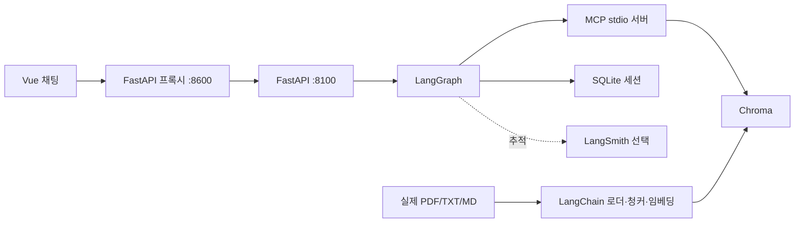
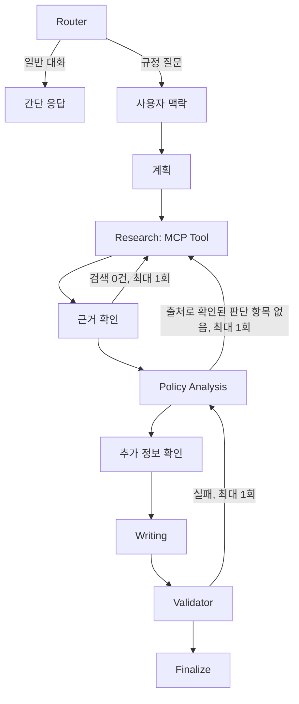

# 아키텍처

`server.py` lifespan이 MCP 세션, 모델 어댑터, SQLite 저장소, 컴파일된 그래프를 한 번 만듭니다. Vue 화면은 same-origin 프록시에서 SSE를 수신합니다. `FinalAnswer`만 완성된 답변으로 렌더링하므로 검증 전 초안이 보이지 않습니다.

## RAG

`rag/loader.py`는 파일 SHA-256, 문서 ID, 도메인, 시행일, 페이지를 붙입니다. `splitter.py`는 조항 경계를 우선 사용하고 긴 조항만 재귀 분할합니다. `vectorstore.py`는 Chroma에 저장하며 동일 해시를 건너뜁니다. `retriever.py`는 도메인 필터와 Top-K를 적용합니다. 빈 인덱스는 검색 결과 0건을 반환합니다. 현재 검색 점수 임계값은 0.25 상당이며 문서별 튜닝 전의 MVP 값입니다.

## 그래프

Research는 `search_policy_documents` Tool을 호출합니다. MCP Resource `policy://documents/{document_id}`는 인덱스의 해당 문서를 조회하고, Prompt `policy_analysis_prompt`는 분석 단계에서 사용합니다. 그래프는 이전 사용자 턴을 검색 문맥에 포함하고, 새 질문에 필요한 조건만 모델에 추가 질문하도록 지시합니다. 질문과 응답은 SQLite에 남아 다음 턴에 복원됩니다.

분석 모델은 자격 상태, 사유, 조건, 서류, 절차, 기한, 부서, 추가 질문을 JSON으로 반환합니다. 확정 판단의 인용 ID와 본문 인용구를 코드가 검사하고, 모델 심사를 한 번 더 거칩니다. 검증이 두 번 실패하면 안전한 판단 유보로 종료합니다. 임의의 적용 확정이 없도록 빈 항목은 표시하지 않습니다.

## 기술 선택

Chroma는 로컬 영속 DB로 별도 서버 운영이 필요 없습니다. LangGraph는 재검색과 재검증 횟수를 상태로 제한합니다. MCP는 기존 stdio 연결과 검색 기능의 경계를 유지합니다. Vue 3 단일 HTML 화면은 기존 빌드 없는 배포 구조를 유지합니다. LangSmith는 환경변수 설정 시 추적에 사용하며 서비스 작동의 필수 조건은 아닙니다.
